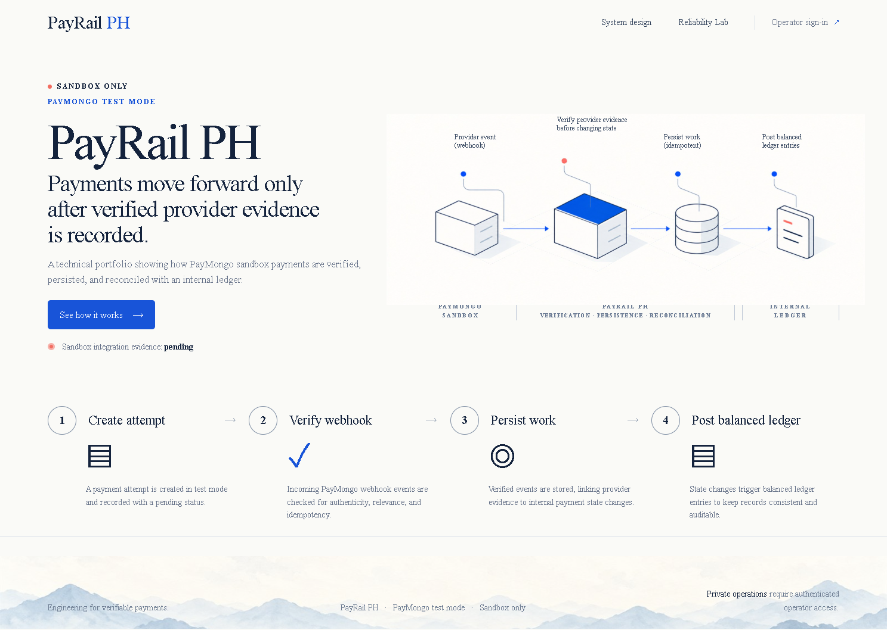
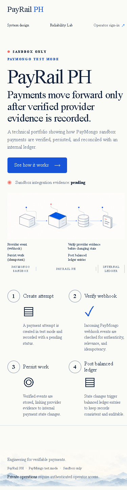

# PayRail PH


**Sandbox-only Philippine payment orchestration portfolio.** PayRail PH is being built to demonstrate safe payment workflows, durable recovery, and clear operational evidence. It does not process live money or accept card data.

## Current status

Phases 00 and 01 are verified locally. M0 — Engineering Core — is still in progress. PayMongo payment creation, webhooks, ledger posting, hosted environments, and deployment URLs are pending their phase gates. Screenshots show the public Build 3 foundation; they are not evidence of payment processing.

| Milestone | Status |
|---|---|
| M0 — Engineering Core | In progress: runnable web/API/PostgreSQL foundation; money and operator isolation pending. |
| M1 — Working Fintech MVP | Pending genuine PayMongo sandbox lifecycle, durable jobs, and ledger verification. |
| M2 — PayMo Portfolio Release | Pending operations, reconciliation, supported refunds, reliability, security, and hosted qualification. |

## Build 3 foundation

The landing page introduces PayRail's operating model and separates public read-only evidence from authenticated financial operations. The payment flow illustration is conceptual until the provider and financial phases are verified.





## Architecture

- **Web:** Next.js public portfolio and future authenticated operations UI.
- **API:** one modular NestJS service with the standard HTTP adapter.
- **Database:** PostgreSQL as the financial system of record. Supabase Auth and environment-scoped private schemas are planned for operator sessions and data.
- **Async work:** PostgreSQL outbox/jobs with leased claims and fencing. A Cloudflare scheduled trigger will wake recovery processing after that phase is implemented.
- **Provider:** PayMongo test mode for Release 1. Provider payloads stay inside the adapter.

No database transaction spans a provider request. A timed-out submission stays unresolved until verified; it cannot trigger a second charge. Public views remain sanitized and read-only. The detailed rules live in [the system architecture](docs/architecture/system.md), [database invariants](docs/architecture/database-invariants.md), and [threat model](docs/security/threat-model.md).

## Run locally

Requirements: Node.js 22.12 or newer in the Node 22 line, pnpm 10.30.3, Git, and PostgreSQL 17 tools on `PATH`.

```powershell
pnpm install --frozen-lockfile
Copy-Item .env.example .env
pnpm db:local:start
pnpm db:migrate
pnpm dev:api
```

In another terminal, run `pnpm dev:web`. The web app listens on `http://localhost:3000`; the API listens on `http://localhost:4000`. The local PostgreSQL cluster is project-owned, stored under ignored `.local/postgres`, and bound to `127.0.0.1:55432`. Stop it with `pnpm db:local:stop`.

Current local variable names are `API_PORT`, `DATABASE_URL`, `WEB_ORIGIN`, and `NEXT_PUBLIC_API_BASE_URL`. `.env.example` contains local-only values. Keep real credentials in ignored local environment files or platform secret settings; never commit or paste them into issues or pull requests. Phase 02 will separate migration credentials from runtime credentials.

## Verification

Available now:

```text
pnpm format:check
pnpm lint
pnpm typecheck
pnpm test:unit
pnpm test:repo-policy
pnpm validate:commits
pnpm build
```

Integration, concurrency, contract, end-to-end, sandbox, security, phase, and deployment commands are added only when their implementation exists. CI runs on `personal/defnotwig`, `dev`, `staging`, and `main`, and on pull requests into protected release branches.

## Git workflow

```text
personal/defnotwig → PR → dev → PR → staging → PR → main
```

Use one implementation pull request per verified phase, Conventional Commit subjects and PR titles ending in their PR number (for example `docs(repo): update workflow (#12)`), current CI, and an independent Codex review record bound to the PR base and diff. GitHub is configured for merge commits only, and `dev`, `staging`, and `main` require PRs, passing `verify` and `review-evidence` checks, and resolved review conversations. Force pushes, branch deletion, and admin bypass are disabled; verify the live repository settings before relying on them. Urgent `fix/*` branches use the same checks and are synchronized downstream. See [CONTRIBUTING.md](CONTRIBUTING.md) for the worktree and promotion workflow.

## Hosted environments

| Environment | Web | API | Status |
|---|---|---|---|
| Dev | Pending | Pending | Free capacity and credential setup not yet verified. |
| Staging | Pending | Pending | Free capacity and credential setup not yet verified. |
| Main | Pending | Pending | Isolated Supabase project and deployment qualification pending. |

When deployed, each row will link to the stable web and API health URLs and a release record for the exact source revision. A deployed sandbox is not a live-money service.

## Safety and scope

PayRail is test-mode only. Never scan or expose sandbox QR codes; use the provider's designated test action. Never enter live payment credentials, PAN, or CVV. Unknown provider outcomes remain visible and require authoritative reconciliation. See [SECURITY.md](SECURITY.md) to report a vulnerability privately.

## License

Original project code is licensed under the MIT License. Third-party packages and assets retain their respective licenses. See [LICENSE](LICENSE).
