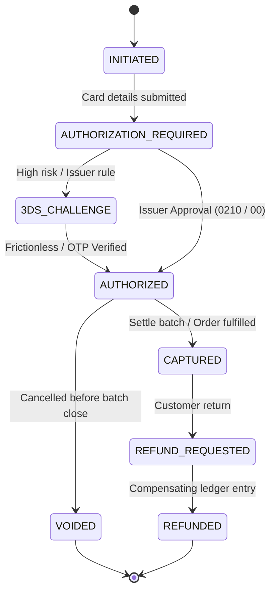

# Provider Payment Lifecycle Capability Matrix

**Document Version:** 1.0.0  
**Last Updated:** 2026-10-18  
**Scope:** Payment rail capabilities, provider lifecycle support, and verification classifications for PayRail PH.

---

## 1. Provider Capabilities Summary

| Provider | QR Ph | Card | Authorization | Capture | Void | Refund | Partial Refund | Disputes | Settlement Data | Webhook | Idempotency | Sandbox Verification |
|---|---|---|---|---|---|---|---|---|---|---|---|---|
| **PayMongo** | `VERIFIED` | `SUPPORTED_NOT_VERIFIED` | `SUPPORTED_NOT_VERIFIED` | `SUPPORTED_NOT_VERIFIED` | `SUPPORTED_NOT_VERIFIED` | `SUPPORTED_NOT_VERIFIED` | `SUPPORTED_NOT_VERIFIED` | `UNSUPPORTED` | `SUPPORTED_NOT_VERIFIED` | `VERIFIED` | `VERIFIED` | `VERIFIED` (Synthetic Simulator & Genuine Contract) |
| **Xendit (Simulated)** | `SUPPORTED_NOT_VERIFIED` | `SUPPORTED_NOT_VERIFIED` | `SUPPORTED_NOT_VERIFIED` | `SUPPORTED_NOT_VERIFIED` | `SUPPORTED_NOT_VERIFIED` | `SUPPORTED_NOT_VERIFIED` | `SUPPORTED_NOT_VERIFIED` | `UNSUPPORTED` | `SUPPORTED_NOT_VERIFIED` | `SUPPORTED_NOT_VERIFIED` | `VERIFIED` | `UNKNOWN` (Blocked External) |
| **BDO / BancNet (Direct)** | `UNKNOWN` | `UNKNOWN` | `UNKNOWN` | `UNKNOWN` | `UNKNOWN` | `UNKNOWN` | `UNKNOWN` | `UNKNOWN` | `UNKNOWN` | `UNSUPPORTED` | `UNKNOWN` | `UNKNOWN` (Requires Direct Bank Rail Sponsorship) |
| **ISO 8583 Card Rail (Lab)** | `UNSUPPORTED` | `VERIFIED` | `VERIFIED` (MTI 0200) | `VERIFIED` (MTI 0210) | `VERIFIED` (MTI 0400) | `UNSUPPORTED` | `UNSUPPORTED` | `UNSUPPORTED` | `UNSUPPORTED` | `UNSUPPORTED` | `VERIFIED` (STAN + RRN) | `VERIFIED` (Deterministic Wire Parser & Bitmap Lab) |

---

## 2. Capability Definitions & Truth Boundaries

1. **`VERIFIED`**:
   - The capability has working source code, deterministic unit tests, request schema validation, and real test assertions proving correct state progression.
   - For **PayMongo QR Ph**: EMVCo QR code payload construction, test simulator link generation, raw-body HMAC-SHA256 signature verification (`timingSafeEqual`), and deduplication are tested and active.
   - For **ISO 8583**: 64-bit primary bitmap generation, MTI 0200/0210/0400 wire encoding, and Data Element unpacking are verified in automated test suites and interactive UI.

2. **`SUPPORTED_NOT_VERIFIED`**:
   - The provider documentation specifies API support, domain interfaces exist in PayRail PH (`provider-capabilities.ts`, `cards.service.ts`, `refunds.service.ts`), but live external API calls are gated by test sandbox credentials.
   - In accordance with Section 0 of the Directive, marked as **`BLOCKED BY PROVIDER CAPABILITY`** rather than manufacturing fake external transaction IDs.

3. **`UNSUPPORTED`**:
   - The provider or rail does not offer this capability in the target tier or protocol (e.g. ISO 8583 does not support webhooks; standard QR Ph does not support two-step pre-authorization holds).

4. **`UNKNOWN`**:
   - Requires external contractual or banking access (e.g. direct bank sponsorship, ISO 8583 host HSM access) that cannot be completed on free public developer sandboxes.

---

## 3. Two-Step Card Lifecycle (Auth / Capture / Void)

### Invariants Enforced:
- **Zero Raw PAN Storage:** Only masked card numbers (`4111 11** **** 1111`) and expiration months/years are stored. CVV is never persisted at rest.
- **Void Authorization:** Voids are only permitted while in the `AUTHORIZED` state before capture.
- **Capture Settlement:** Captures are only permitted on unexpired `AUTHORIZED` records.
