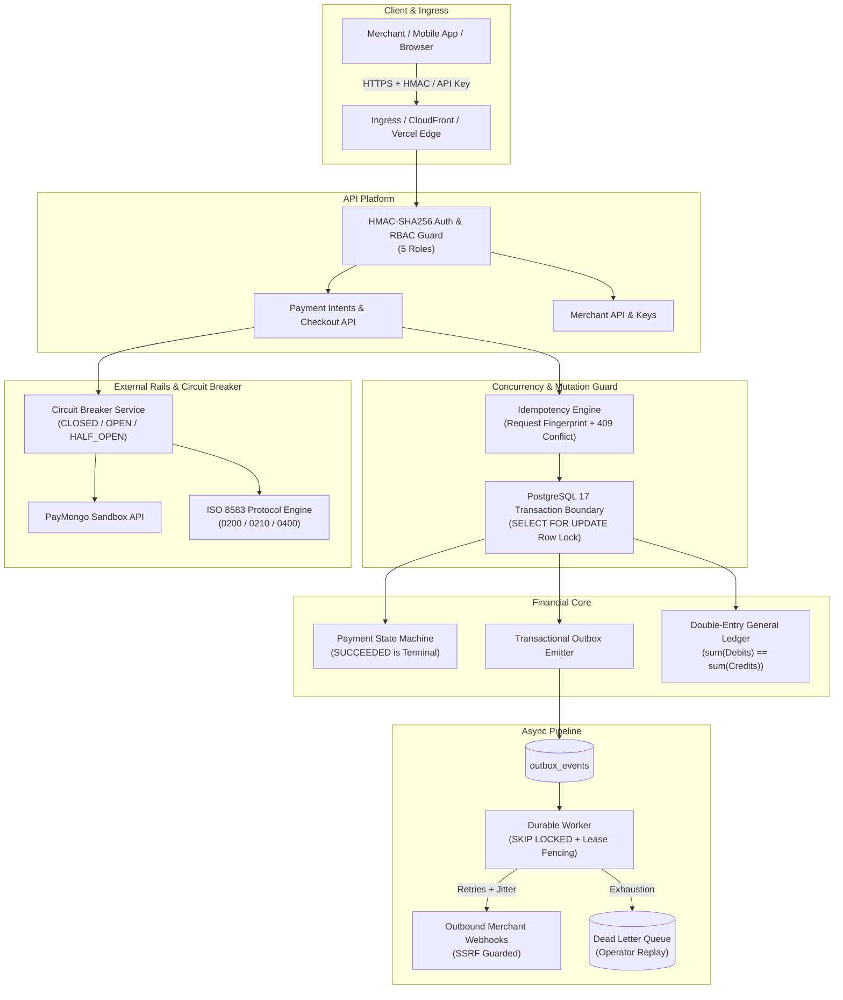

# PayRail PH — PayMo Engineering Interview Pack
## Role: Software Engineer — Fintech & Payment Channels (PayMo Co. Inc.)

---

## 1. Two-Minute Executive Pitch

> "PayRail PH is a production-shaped Philippine payment orchestration and financial operations platform engineered to demonstrate high-concurrency payment reliability, mathematical accounting integrity, and regulatory compliance. Rather than building a generic CRUD application, PayRail PH solves the hardest distributed systems problems in modern fintech: preventing double charges under network failures via pessimistic row-level locking (`SELECT ... FOR UPDATE`), maintaining an immutable double-entry general ledger with balanced debit-credit invariants, executing multi-partial refunds with atomic capacity reservations, and guaranteeing at-least-once asynchronous delivery through a transactional outbox and durable `SKIP LOCKED` workers with dead-letter queue recovery.
>
> It features a live EMVCo QR Ph test payment slice integrated with PayMongo, educational ISO 8583 wire protocol encoding with a 64-bit primary bitmap inspector, SSRF-hardened outbound merchant webhooks with HMAC signatures, and an interactive Reliability Lab where engineers can inject chaos—such as 10x concurrent webhook storms and circuit breaker trips—in real time. The entire platform is deployed to production, fully typed in strict TypeScript with zero floating-point arithmetic on currency, and backed by comprehensive automated test suites and production incident runbooks."

---

## 2. Five-Minute Technical Architecture Walkthrough



### Key Pillars:
1. **Financial Precision:** Currency is represented strictly as `bigint` minor units (e.g., centavos). JavaScript `number` floats are prohibited in calculations to avoid IEEE 754 rounding bugs.
2. **Pessimistic Concurrency:** Webhooks and payment mutations acquire `SELECT ... FOR UPDATE` locks on the target `payment_intent_id`. Concurrent webhook storms serialize cleanly at the database level.
3. **Idempotency with Cryptographic Fingerprints:** Keys are mapped to SHA-256 request payload hashes. Replays with the identical payload return the existing resource; replays with a modified payload result in an immediate `409 Conflict`.
4. **General Ledger Balance Invariant:** Every financial transaction creates paired debit and credit journal lines. Transactions fail immediately if $\sum \text{Debits} \ne \sum \text{Credits}$.
5. **Safe Asynchronous Processing:** The transactional outbox pattern guarantees that jobs are only queued if the database commit succeeds. Workers claim jobs using `SELECT ... FOR UPDATE SKIP LOCKED` with lease expiration fencing.

---

## 3. Core Architectural Explanations

### 3.1 QR Ph Payment Lifecycle
1. Merchant requests `POST /v1/payments/qrph/intents` with amount, currency (`PHP`), and `Idempotency-Key`.
2. PayRail generates a `PaymentIntent` in `CREATED` state, inserts an idempotency record, and calls the provider adapter.
3. PayMongo returns a dynamic QR code payload; state transitions to `AWAITING_PAYMENT`.
4. Customer scans QR code in digital wallet (GCash, Maya, ShopeePay) and authorizes payment.
5. PayMongo issues an inbound HTTPS webhook to `/v1/webhooks/paymongo`.
6. Webhook service extracts the raw request body, verifies the HMAC-SHA256 signature against the shared secret using `crypto.timingSafeEqual`, and deduplicates the event via `provider_events`.
7. Within a PostgreSQL transaction, the payment intent is locked via `SELECT FOR UPDATE`, transitioned to `SUCCEEDED`, and an immutable `payment_state_events` audit record is created.
8. A double-entry journal entry is atomically posted:
   - Debit: Account `1020` (Settlement Clearing / Receivable)
   - Credit: Account `2010` (Merchant Payable)
9. An outbox event `payment.succeeded` is emitted to notify merchant webhooks.

### 3.2 Handling Ambiguous Provider Timeouts
- When calling PayMongo or an external payment rail, if the HTTP socket times out or returns `504 Gateway Timeout`, the outcome is **UNKNOWN**.
- **Rule:** PayRail **NEVER** creates a secondary charge or retries a payment attempt automatically upon a timeout.
- The state transitions to `UNKNOWN_REQUIRES_RECONCILIATION`.
- Downstream background reconciliation workers query the provider's resource endpoint or wait for an authoritative webhook to resolve the definitive state before updating the ledger.

### 3.3 Duplicate and Out-of-Order Webhooks
- **Duplicate Webhooks:** If the provider sends the same `evt_...` webhook 10 times in parallel:
  - The unique constraint on `(provider, environment, provider_event_id)` catches parallel inserts.
  - The row lock serializes execution; subsequent executions see the payment is already `SUCCEEDED` and return an idempotent `HTTP 200` without duplicate ledger postings.
- **Out-of-Order Webhooks:** If a delayed `payment.failed` event arrives after a `payment.succeeded` event:
  - The state machine guard detects that `SUCCEEDED` is a **terminal state**.
  - The transition to `FAILED` is rejected, preserving financial integrity.

### 3.4 Double-Entry Ledger Mechanics
- **Chart of Accounts:**
  - `1010`: Cash & Bank Accounts (Asset)
  - `1020`: Payment Channel Clearing / Accounts Receivable (Asset)
  - `2010`: Merchant Payables (Liability)
  - `4010`: Payment Processing Fee Revenue (Revenue)
- **Constraint:** $\sum \text{Debits} == \sum \text{Credits}$ per currency per transaction.
- **Audit Rule:** No row in `journal_entries` or `ledger_lines` is ever updated or deleted. Corrections are made solely via compensating journal entries (e.g. refund journal entry reversing clearing to payable).

### 3.5 Controlled Multi-Partial Refunds
- To prevent refund race conditions (e.g. 5 concurrent refund requests of ₱500 on a ₱1,000 charge):
  - The transaction executes `SELECT amount_minor FROM payment_intents WHERE id = $1 FOR UPDATE`.
  - It locks and aggregates all existing non-failed refunds: $\text{CurrentRefunded} = \sum(\text{confirmed} + \text{pending})$.
  - Invariant checked: $\text{CurrentRefunded} + \text{RequestedAmount} \le \text{PaymentTotal}$.
  - If valid, a refund record in `PENDING` state is inserted, locking the capacity before external dispatch.

### 3.6 Transactional Outbox & Worker Fencing
- Workers claim batches of pending jobs with:
  ```sql
  SELECT * FROM durable_jobs
  WHERE state = 'PENDING' OR (state = 'RUNNING' AND lease_expires_at < clock_timestamp())
  ORDER BY priority DESC, created_at ASC
  LIMIT $1
  FOR UPDATE SKIP LOCKED;
  ```
- Workers receive an incremental `fencing_token`. If a worker hangs (e.g. long GC pause) and its lease expires, a second worker claims the job. When the first worker wakes up, its mutation fails if its fencing token does not match the active lease token.

---

## 4. Top 20 Technical Interview Defenses

#### Q1: Why did you choose PostgreSQL with `SELECT ... FOR UPDATE` instead of an in-memory Redis lock or Redlock?
**Answer:** In-memory distributed locks like Redlock suffer from clock drift, GC pause split-brains, and network partitioning failures. More critically, Redis locks are decoupled from the database transaction boundary: a Redis lock can expire or be released while the PostgreSQL transaction is still committing. By utilizing PostgreSQL row-level pessimistic locking (`SELECT ... FOR UPDATE`), the lock lifetime is bound to the ACID database transaction boundary. If the transaction crashes, rolling back automatically releases the lock without orphan lock cleanup bugs.

#### Q2: How do you prevent floating-point rounding errors on fees and currency in JavaScript/Node.js?
**Answer:** JavaScript `number` uses IEEE 754 double-precision floats, which causes precision loss (e.g. `0.1 + 0.2 === 0.30000000000000004`). In PayRail PH, all currency amounts are stored and calculated as `bigint` minor units (e.g. 100 centavos = ₱1.00). In PostgreSQL, amounts are stored as `BIGINT`. On the network wire, amounts are transmitted as exact decimal strings. Calculations involving basis points use integer division with explicit, documented rounding strategies (e.g. floor vs round half-up).

#### Q3: How does PayRail prevent double-charging when a merchant network connection drops before receiving our response?
**Answer:** Merchants must provide a unique `Idempotency-Key` header with mutation requests. PayRail computes a SHA-256 fingerprint of the request payload and checks the `payrail_private.idempotency_records` table within the same transaction. If an identical request is received, PayRail returns the cached payment resource. If a conflicting request with the same key but altered parameters is received, PayRail returns an immediate `409 Conflict`.

#### Q4: If PayMongo experiences an outage and returns 500 or times out, how does PayRail ensure connection pools aren't exhausted?
**Answer:** We implemented a 3-state Circuit Breaker (`CLOSED`, `OPEN`, `HALF_OPEN`). When 5 consecutive downstream errors occur within a 30-second window, the circuit trips to `OPEN`. All subsequent payment submissions immediately fast-fail (0ms latency) with `503 Service Unavailable`, preventing worker threads and database connection pools from becoming blocked. Read endpoints, webhook ingress, and local reconciliation continue operating without interruption. After a 15-second cooldown, the circuit enters `HALF_OPEN` and permits a single canary probe to test provider recovery.

#### Q5: What is the transactional outbox pattern, and why is it necessary for fintech webhooks?
**Answer:** In distributed systems, publishing an event to a message broker (or sending an HTTP webhook) and updating a database cannot be done in a single two-phase commit without high latency and failure risk. If the DB commits but the webhook fails, the event is lost. If the webhook succeeds but the DB rolls back, phantom events are sent. With the transactional outbox pattern, the domain mutation and the `outbox_events` record are inserted into PostgreSQL within the same atomic transaction. An asynchronous durable worker polls and dispatches outbox events reliably with exponential backoff and jitter.

#### Q6: How do you protect merchant outbound webhooks against Server-Side Request Forgery (SSRF)?
**Answer:** Malicious merchants might register internal VPC IP addresses (such as `127.0.0.1`, `localhost`, or AWS metadata `169.254.169.254`) as their webhook endpoints to extract credentials. PayRail validates every webhook target URL before registration and delivery:
1. It verifies the protocol is strictly `https:`.
2. It resolves the hostname and validates the destination IP against CIDR blocks for loopback (`127.0.0.0/8`, `::1`), private subnets (`10.0.0.0/8`, `172.16.0.0/12`, `192.168.0.0/16`), and cloud link-local metadata addresses (`169.254.169.254`). Any forbidden IP is rejected with `400 Bad Request`.

#### Q7: Why is `crypto.timingSafeEqual` required for webhook signature verification?
**Answer:** Standard string equality (`===`) short-circuits on the first mismatched character. Attackers can measure the timing differences of thousands of HTTP requests with varying signature bytes to deduce the expected signature byte by byte (timing side-channel attack). `crypto.timingSafeEqual` compares the byte arrays in constant time regardless of where or whether mismatches occur, preventing timing-based signature forgery.

#### Q8: How does PayRail ensure that `payment.succeeded` is never overwritten by an out-of-order `payment.failed` webhook?
**Answer:** Payment states are governed by a strict finite state machine enforced by PostgreSQL constraints and service guards. In `payrail.payment_intents`, `SUCCEEDED` is defined as a terminal state. When a webhook arrives, the current state is locked with `SELECT state FROM payment_intents FOR UPDATE`. If the current state is `SUCCEEDED`, the transition rules dictate that no subsequent failure or expiration event can alter the state.

#### Q9: What happens if two merchants share the same database instance? How do you prevent BOLA / IDOR?
**Answer:** PayRail enforces multi-tenant row-level isolation. Every database table includes a non-nullable `merchant_id` column. Controllers and repositories extract the authenticated `merchantId` from the cryptographically verified session token or API key, and inject `WHERE merchant_id = $1` into every single query. API routes access resources using composite keys `(id, merchant_id)`. Accessing an ID belonging to another merchant returns `404 Not Found`.

#### Q10: How are Merchant API keys stored securely?
**Answer:** Like passwords, API keys are credentials that must never be stored in plaintext. When an API key is generated (e.g. `sk_test_...`), the plaintext key is displayed to the operator exactly once. The database only persists the SHA-256 cryptographic digest of the key along with its prefix (`sk_test_`) for UI identification. During API authentication, incoming keys are hashed with SHA-256 and compared against stored hashes.

#### Q11: Explain your 3-way automated reconciliation algorithm.
**Answer:** Daily reconciliation matches three independent sources of truth:
1. **Local Payment Intents:** Transactions recorded in PayRail's database.
2. **Provider Settlement Observations:** Authoritative settlement feeds from the PSP.
3. **Internal General Ledger:** The posted journal entries and balances.
Transactions are categorized as `MATCHED`, `LOCAL_ONLY` (missing at provider), `PROVIDER_ONLY` (unrecorded charge), or `STATUS_MISMATCH`. Safe deterministic auto-repairs sync terminal statuses and create balancing compensating entries without manual database interventions.

#### Q12: How does PayRail prevent Dead Letter Queue (DLQ) overflow from poisoning workers?
**Answer:** When an asynchronous job fails repeatedly (exceeding `max_retries = 3`) due to an unrecoverable error (such as HTTP 422 or malformed payload), the job is moved to `DEAD_LETTER` state. Quarantining poisoned messages keeps the active worker queue clear for healthy throughput. Operators can inspect the error trace, stack trace, and payload in the Operations Portal and trigger an audited manual replay once downstream dependencies are restored.

#### Q13: What is the primary difference between ISO 8583 and modern REST payment APIs?
**Answer:** ISO 8583 is a compact binary/bitmap financial message protocol used by card networks (Visa, Mastercard, BancNet) and POS terminals over raw TCP/IP sockets. Unlike verbose JSON, fields are designated as Data Elements (DE) indicated by a 64-bit or 128-bit bitmap. Message Type Identifiers (MTI) indicate the transaction type (e.g. `0200` for Authorization Request, `0210` for Authorization Response, `0400` for Reversal). Modern REST APIs trade bandwidth efficiency for developer ergonomics, schema flexibility, and web standard integration.

#### Q14: How does PayRail handle card pre-authorization, capture, and void?
**Answer:** For card rails supporting two-step clearing:
1. `AUTHORIZE`: Reserves customer credit line without capturing funds. State becomes `AUTHORIZED`.
2. `CAPTURE`: Settles the transaction upon goods fulfillment. State becomes `CAPTURED`, creating ledger clearing entries.
3. `VOID`: Cancels the hold before settlement batch cutoff, releasing customer credit without interchange fees.

#### Q15: Why is PCI DSS v4.0 scoping critical, and how does PayRail avoid PCI SAQ D obligations?
**Answer:** PayRail operates as an orchestration platform. Card details are collected using tokenized, provider-hosted fields (e.g. PayMongo Elements or Xendit Hosted Fields). Raw PANs and CVVs never touch PayRail's web servers, API instances, or database tables. PayRail only handles masked PANs (`4111 11** **** 1111`) and provider tokens, reducing our compliance obligation from the rigorous SAQ D to the lightweight SAQ A.

#### Q16: How would you migrate PayRail from Vercel to a multi-region AWS production architecture?
**Answer:** In [`docs/architecture/aws-production-blueprint.md`](file:///C:/Users/Ludwig%20Rivera/Downloads/PAYRAIL%20PH/docs/architecture/aws-production-blueprint.md), we mapped out the migration:
- **Edge/CDN:** AWS CloudFront with AWS WAF for DDoS mitigation and rate limiting.
- **Compute:** ECS Fargate containers running NestJS API within private VPC subnets across 3 Availability Zones.
- **Database:** Amazon Aurora PostgreSQL Multi-AZ with automated failover and read replicas.
- **Queue:** Amazon SQS FIFO for ordered outbox processing with Dead Letter Queues.
- **Secrets:** AWS Secrets Manager with automatic KMS rotation.

#### Q17: What are Google SRE Multi-Window Multi-Burn-Rate alerts, and how are they configured in PayRail?
**Answer:** Traditional single-threshold alerts trigger false positives on minor spikes or notify too late during slow outages. Multi-window multi-burn-rate alerts monitor the consumption rate of our 99.95% Availability Error Budget across two concurrent windows:
- **Fast Burn:** 14.4x burn rate over 1 hour (consumes 2% of budget in 1 hour) triggers immediate PagerDuty page.
- **Slow Burn:** 6x burn rate over 6 hours (consumes 5% of budget in 6 hours) triggers engineering review before SLO exhaustion.

#### Q18: What is lease fencing, and how does it prevent dual-worker split-brain executions?
**Answer:** When worker A claims a job with a 30-second lease, an unexpected network partition or GC pause might cause the lease to expire while worker A is still computing. Worker B claims the job and receives fencing token `N+1`. If worker A awakens and attempts to commit with fencing token `N`, the database rejects the update (`WHERE fencing_token = $expected`), ensuring that stale workers cannot corrupt data.

#### Q19: What is the difference between an Acquiring Bank, an Issuing Bank, and a Payment Orchestration Platform like PayRail?
**Answer:** An Issuing Bank issues the payment card or digital wallet account to the consumer (e.g. BPI, GCash). An Acquiring Bank holds the merchant's financial account and maintains direct membership in the card or clearing network (e.g. Visa, Mastercard, BancNet, PhilPaSSplus). PayRail PH is a Payment Orchestration Platform: it provides intelligent routing, unified APIs, double-entry ledgering, and reconciliation on top of multiple PSPs and acquirers without holding customer deposits directly.

#### Q20: If you discovered a ₱1,000,000 ledger imbalance in production, what are your immediate triage steps?
**Answer:** According to our Runbook (`docs/runbooks/ledger-imbalance.md`):
1. **P0 Incident Declaration:** Assemble incident commander, lead engineer, and finance ops.
2. **Execute Invariant Query:** Run the general ledger imbalance verification query to isolate the specific currency, transaction ID, and mismatched accounts.
3. **Quarantine Affected Merchant / Channel:** Temporarily pause automatic settlement sweeps for the affected channel.
4. **Determine Root Cause:** Identify whether the discrepancy was caused by an unhandled partial refund, orphaned provider event, or concurrent race.
5. **Post Compensating Entry:** Never modify historical ledger records directly. Post an audited compensating journal entry referencing the incident ID, verified by finance authorization.
