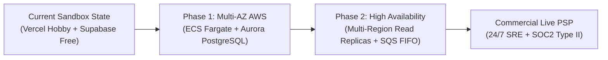

# PayRail PH — Commercial Production Gap Analysis

**Document Version:** 1.0.0  
**Classification:** Engineering & Regulatory Evaluation  
**Author:** Principal Platform Architect  
**Date:** 2026-10-18  

---

## 1. Executive Summary

PayRail PH demonstrates advanced architectural maturity in financial state consistency, double-entry general ledger mechanics, multi-partial refund reservations, asynchronous job fencing, and high-concurrency payment orchestration.

However, moving from a **production-shaped sandbox platform** to a **commercial production payment gateway handling real Philippine Peso funds** requires addressing explicit regulatory, legal, contractual, and infrastructure prerequisites. This document details the exact gap analysis and operational roadmap required for live commercial enablement.

---

## 2. Regulatory & Legal Prerequisites (Bangko Sentral ng Pilipinas)

| Gap Domain | Commercial Production Requirement | Current Sandbox Status | Action Required for Live Launch |
|---|---|---|---|
| **OPS Registration** | Registration with Bangko Sentral ng Pilipinas (BSP) as an Operator of Payment Systems (OPS) under Republic Act No. 11127 (The National Payment Systems Act). | Sandbox orchestration platform; does not hold customer funds. | Formal application filing with BSP Payments and Settlements Department (PSD); submission of business plan, governance charter, and financial capacity statements. |
| **AML/CFT Compliance** | Mandatory Anti-Money Laundering Council (AMLC) registration and reporting compliance under RA 9160 (AMLA) as amended. | Sandbox simulation; test merchants only. | Integration with automated Sanction Screening and Politically Exposed Persons (PEP) watchlist APIs (e.g. Refinitiv World-Check or Dow Jones); appointment of Compliance Officer. |
| **Data Privacy (RA 10173)** | Registration of Data Processing Systems with the National Privacy Commission (NPC) for personal financial data processing. | Documented data minimization and 5-year retention policy (`docs/security/privacy.md`). | Filing of Data Privacy Manual with NPC; execution of formal Data Sharing Agreements (DSA) with acquiring partners. |

---

## 3. Commercial Banking & PSP Contracts

| Domain | Production Requirement | Sandbox Limitation | Production Path |
|---|---|---|---|
| **Live Merchant Acquiring** | Executed commercial acquiring agreement with licensed Philippine acquiring banks or PSPs (e.g. PayMongo Live, Maya Business, Xendit, BDO). | Operating on PayMongo Sandbox environment (`PAYMENTS_MODE=test`). | Undergo commercial underwriting, corporate KYC/KYB verification, and merchant fee schedule execution (MDR negotiations). |
| **Direct Clearing Access** | Direct participant sponsorship in Philippine Clearing House Corporation (PCHC) for automated batch settlement. | Simulated settlement import via CSV/JSON fixtures. | Establish formal sponsorship bank relationship (e.g. UnionBank, BPI) for direct InstaPay / PESONet clearing rails. |
| **Merchant Escrow / FBO Accounts** | For Benefit Of (FBO) segregated customer fund escrow accounts with a universal bank. | Zero customer custody; no real money accounts. | Open segregated trust accounts guaranteeing 100% reserve backing for funds in transit. |

---

## 4. Security & Compliance Roadmap

1. **PCI DSS Level 1 Attestation of Compliance (AoC):**
   - While PayRail's tokenized architecture reduces merchant scope to SAQ A, an enterprise payment service provider must complete an independent Qualified Security Assessor (QSA) audit to issue an AoC and Report on Compliance (RoC).
2. **Third-Party Penetration Testing:**
   - Formal black-box and white-box penetration testing conducted by an accredited CREST-certified cybersecurity consultancy against production APIs, webhooks, and cloud infrastructure.
3. **Hardware Security Modules (HSM):**
   - For direct card network clearing (Visa/Mastercard/BancNet), transition from software HMAC keys to dedicated FIPS 140-2 Level 3 Hardware Security Modules (AWS CloudHSM) for PIN block translation and key generation.

---

## 5. Production Infrastructure & Operational Hardening

1. **High-Availability Compute:**
   - Migrate from serverless functions to Multi-AZ Amazon ECS Fargate or EKS clusters with dedicated auto-scaling worker pools (`min: 4`, `max: 32`).
2. **Database Resilience:**
   - Deploy Amazon Aurora PostgreSQL Multi-AZ with Cross-Region Automated Backups and a 1-minute Recovery Point Objective (RPO) and < 30-second Recovery Time Objective (RTO).
3. **24/7 Follow-the-Sun SRE On-Call:**
   - Formally staff 24/7 on-call rotations utilizing PagerDuty, linked to our 9 documented incident runbooks (`docs/runbooks/*.md`).
4. **Dispute & Chargeback Operations Desk:**
   - Stand up an operational disputes team to handle representation and evidence submission within 7 days of issuer chargeback notices.
