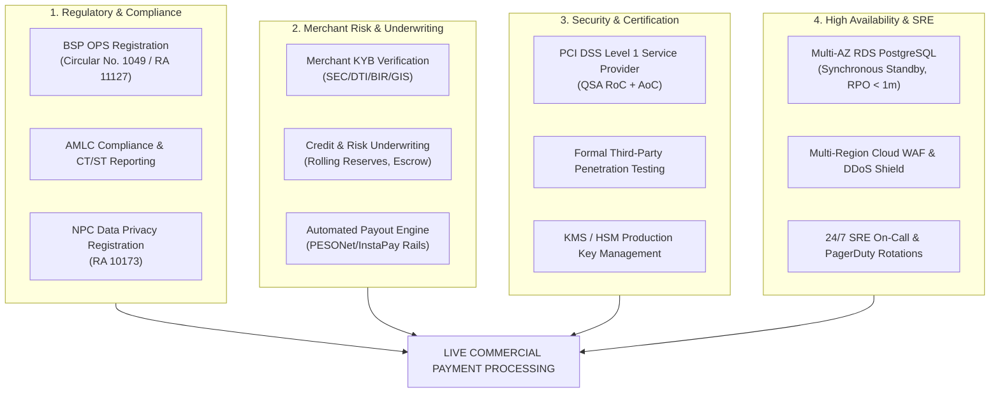

# Commercial Production Gap Analysis & Operational Prerequisites

**Platform:** PayRail PH  
**Document Version:** 1.0.0  
**Date:** 2026-10-18  
**Classification:** Confidential — Engineering & Regulatory Architecture  

---

## 1. Executive Summary & Purpose

PayRail PH is engineered as a production-grade Philippine payment orchestration and ledger platform. In its current implementation, the core financial state machine, double-entry ledger, idempotency engine, merchant API security, outbound webhook SSRF defense, and PayMongo QR Ph adapter are fully developed and deterministically tested.

However, moving from a verified sandbox orchestrator to a live commercial financial institution handling Philippine Peso (PHP) funds requires navigating strict regulatory frameworks, banking clearing networks, enterprise security compliance, and high-availability operations.

This document outlines the mandatory operational, legal, infrastructure, and security prerequisites that must be satisfied before processing live customer funds.

---

## 2. Bangko Sentral ng Pilipinas (BSP) & Legal Compliance

Processing real payment transactions in the Republic of the Philippines falls under the statutory authority of the Bangko Sentral ng Pilipinas.

### 2.1 Operators of Payment Systems (OPS) Registration
* **Governing Law:** Republic Act No. 11127 (National Payment Systems Act - NPSA) and BSP Circular No. 1049.
* **Prerequisite:** PayRail PH must register as an Operator of Payment Systems (OPS) under Category 3 (Merchant Aggregator / Payment Gateway / Orchestrator).
* **Capitalization Requirements:** Minimum capital requirements according to BSP regulations (typically ₱10M–₱50M depending on whether custody of customer funds is maintained).
* **Escrow / Trust Accounts:** If funds are held prior to merchant settlement, funds must reside in a BSP-approved segregated Trust/Settlement Account with a Universal/Commercial Bank (UKB) and cannot be commingled with operating capital.

### 2.2 AMLC & Financial Crime Compliance
* **Governing Body:** Anti-Money Laundering Council (AMLC).
* **Mandates:**
  - Automated Covered Transaction Reporting (CTR) for single transactions exceeding ₱500,000 (or equivalent in foreign currency).
  - Suspicious Transaction Reporting (STR) within 5 calendar days of detection for velocity anomalies, structuring, or unusual spikes.
  - Politically Exposed Persons (PEP) and Sanctions Screening (OFAC, UN, local AMLC blacklist) integrated into merchant onboarding.

### 2.3 Data Privacy Act of 2012 (RA 10173)
* **National Privacy Commission (NPC):** Mandatory registration of data processing systems handling more than 1,000 sensitive records.
* **Data Protection Officer (DPO):** Formal designation of a certified DPO and publication of a Privacy Management Program (PMP).
* **Data Residency:** Archival of financial records within Philippine territory or approved cross-border data transfer jurisdictions with equivalent protection for 5 years per BSP requirements.

---

## 3. Merchant Underwriting & Production KYC/KYB

In sandbox mode, merchants are registered with placeholder identifiers (`merchant_default`). Commercial readiness requires an end-to-end Merchant Acquisition & Risk Pipeline:

| Requirement | Minimum Required Evidence | Verification Mechanism |
|---|---|---|
| **Corporate Identity** | SEC Certificate of Incorporation / DTI Business Registration | Electronic SEC/DTI verification |
| **Tax Authority Registration** | BIR Form 2303 (Certificate of Registration) + Official Receipts sample | BIR TIN online validation |
| **Local Government Authorization** | Valid Mayor's Permit / Business Permit for current fiscal year | Local LGU validation |
| **Ultimate Beneficial Owners (UBO)** | Latest General Information Sheet (GIS) indicating shareholders >= 25% | Government-issued IDs + biometric liveness |
| **Risk Scoring & Rolling Reserves** | Financial statements, processing history, MCC category risk tiering | Underwriting engine assigning rolling reserve (e.g., 5-10% held for 180 days) |
| **Settlement Payout Rail** | Dedicated bank account name matching registered business entity | Penny-deposit bank account verification via PESONet |

---

## 4. Formal Information Security & PCI DSS Certification

While PayRail PH implements tokenization, raw-body HMAC verification, and excludes PAN/CVV from database storage, production certification requires formal audit milestones:

### 4.1 PCI DSS Level 1 Service Provider Certification
* **Current State:** Architecture is designed for PCI Scope Reduction (card data is either handled via 3DS redirect/provider iframe or tokenized).
* **Production Prerequisite:**
  - Annual Report on Compliance (RoC) issued by an accredited Qualified Security Assessor (QSA).
  - Quarterly external network scans conducted by an Approved Scanning Vendor (ASV).
  - Formal Attestation of Compliance (AoC) submitted to Visa and Mastercard.

### 4.2 Independent Penetration Testing & Threat Modeling
* **Scope:** White-box and gray-box penetration test conducted by an external CREST- or OSCP-certified firm covering:
  - OWASP Top 10 API Security Risks (especially BOLA/IDOR, broken authentication, SSRF in webhook delivery).
  - Concurrency race conditions on double-entry ledger postings and refund capacity reservations.
  - Fault injection against circuit breakers and outbox worker lease fencing.

### 4.3 Hardware Security Modules (HSM) & Production Secrets
* **Current State:** Secrets (`PAYMONGO_SECRET_KEY`, `WEBHOOK_ENCRYPTION_KEY`) reside in environment variables.
* **Production Prerequisite:**
  - Migration to AWS KMS / HashiCorp Vault with dedicated Envelope Encryption (AES-256-GCM data encryption keys).
  - Automated 90-day key rotation with backward-compatible versioned decryption (`v1`, `v2`).
  - HSM-backed cryptographic key generation for merchant signing secrets.

---

## 5. Infrastructure Resilience, Multi-AZ & Disaster Recovery

| Architectural Layer | Current Sandbox State | Production Target Architecture | Gap / Action Plan |
|---|---|---|---|
| **Database (PostgreSQL)** | Single-instance PostgreSQL 17 on `127.0.0.1:55432` / Supabase pool | AWS RDS PostgreSQL Multi-AZ with synchronous standby in `ap-southeast-1a` and `ap-southeast-1b` | Provision Multi-AZ Aurora/RDS cluster with automated failover (< 30s RTO) |
| **Point-in-Time Recovery** | Manual SQL backup scripts | Continuous WAL archiving to Amazon S3 with 5-minute RPO | Enable automated daily snapshot and WAL log retention for 35 days |
| **Compute / API Runtime** | Vercel Edge / Node.js serverless functions | Containerized NestJS API on AWS ECS Fargate across 3 Availability Zones | Set up autoscaling target tracking (CPU > 65% or p95 > 200ms) |
| **Worker / Outbox Engine** | Node.js process with `SKIP LOCKED` | Distributed workers managed via ECS tasks with lease heartbeat fencing | Implement supervisor container with Kubernetes or AWS ECS service |
| **Edge & DDoS Mitigation** | Basic HTTP headers & CORS in NestJS | Cloudflare Enterprise / AWS CloudFront with AWS WAF & Shield Advanced | Deploy managed OWASP rule set, bot management, and L7 rate limiting |
| **Rate Limiting** | Edge/Reverse proxy reliance | Redis-backed distributed token bucket algorithm (`ioredis` + Redis Sentinel) | Implement in-memory distributed rate limiter (e.g., 100 req/sec per merchant key) |

---

## 6. 24/7 Operations, SRE & Incident Response

### 6.1 Service Level Objectives (SLOs) & Production SLAs
* **Availability SLA:** 99.95% uptime for payment ingestion endpoints (`POST /payments`, `POST /webhooks/paymongo`).
* **Latency SLO:** p95 latency < 350ms for payment intent creation; p99 latency < 800ms.
* **Financial Ledger Balancing SLA:** 100% debit-credit parity verified in real time (zero tolerance for drift).

### 6.2 Incident Escalation & On-Call Rotation
* **Tooling:** PagerDuty / OpsGenie integrated with Datadog / Grafana Cloud.
* **Escalation Policy:**
  - Severity 1 (Payment Ingestion Down / Provider Webhook Outage): Alert on-call primary within 2 minutes; auto-escalate to secondary within 5 minutes; executive notification at 15 minutes.
  - Severity 2 (Reconciliation Discrepancy > ₱10,000): Alert Finance and SRE on-call within 15 minutes.
  - Severity 3 (Asynchronous Job DLQ Depth > 50): Alert engineering during working hours.

### 6.3 Runbook Dry-Runs & Chaos Engineering
* Bi-monthly incident game days simulating:
  - Total primary database node failure (testing automated standby promotion).
  - Outbound webhook receiver blackout (testing exponential backoff and DLQ diversion).
  - PayMongo API 503 outage (testing circuit breaker tripping and graceful fallback).

---

## 7. Direct Bank Clearing & Settlement Rails

For PayRail PH to settle real funds to merchants without intermediate third-party payment facilitators:

1. **Direct Sponsor Bank Partnership:** Sponsoring relationship with a major Philippine Universal Bank (e.g., BDO, BPI, UnionBank, Metrobank).
2. **Direct Clearing Network Access:**
   - **PESONet Participant:** Batch Electronic Fund Transfer for end-of-day T+1 net settlement to merchant bank accounts.
   - **InstaPay Participant:** Real-time retail electronic payment system for instant refunds and instant merchant disbursements (< ₱50,000).
   - **BancNet Switch Direct Member:** Direct ISO 8583 card processing connection bypassing secondary aggregators.
3. **Automated Daily Settlement Cutoff:**
   - EOD ledger snapshot at 23:59:59 PHT.
   - Generation of clearing files in NACHA / ISO 20022 `pacs.008` XML format.
   - SFTP transmission to sponsor clearing bank under mutual TLS (mTLS) and PGP encryption.
